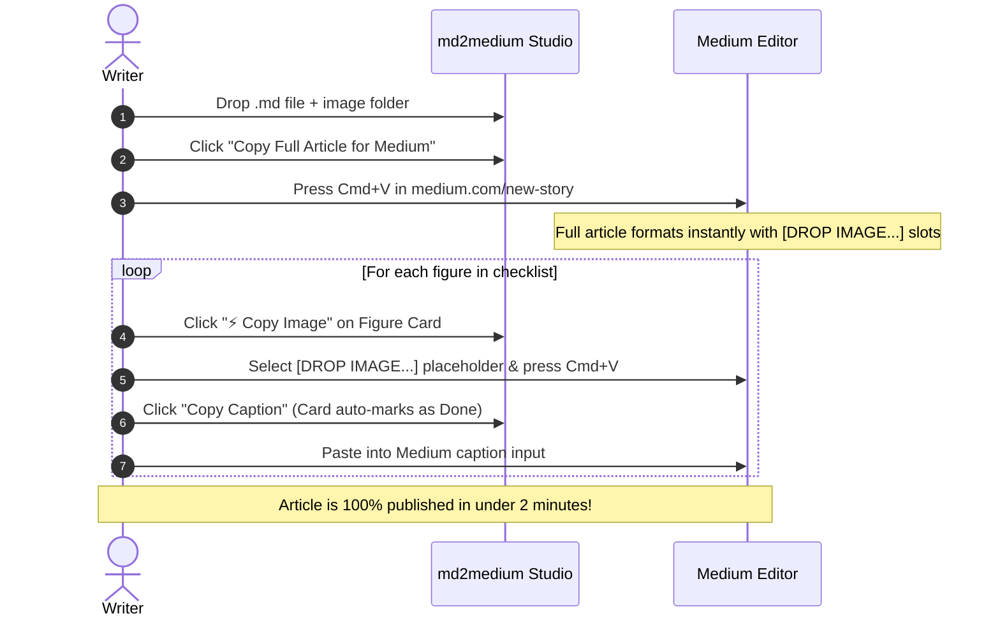

# md2medium Studio ✍️⚡

> **The zero-backend, 100% client-side publishing studio for technical Markdown articles.**  
> Seamlessly port Markdown articles with local images, captions, code blocks, and tables into **Medium**, **Substack**, and **LinkedIn Articles** with one-click rich-text copy.

[](https://github.com/NavinYP/md2medium)
[](https://opensource.org/licenses/MIT)
[](https://github.com/NavinYP/md2medium/actions/workflows/deploy.yml)

---

## 💡 The Problem We Are Solving

When technical writers draft in Markdown (Cursor, VS Code, Obsidian, GitHub) and move to Medium:
1. **Medium strips HTML `<table>` tags on paste:** Table cells are flattened into unreadable stacked paragraphs.
2. **Local images cannot be pasted from Markdown:** Browser security blocks `file://` or local paths from being imported into web editors.
3. **Captions & Alt-text tracking is tedious:** Writers lose their place manually matching 15–25 figure captions and alt texts.
4. **Medium's URL importer leaks drafts:** `medium.com/p/import` requires hosting drafts publicly first and permanently pollutes the article's SEO `rel="canonical"` URL.

---

## ⚡ Key Features

### 1. Flexible Input & 100% Local Asset Resolution
- **Drop Zone:** Drag-and-drop a `.md` file alongside a local image folder (or multiple `.png`/`.jpg`/`.webp`/`.svg` files).
- **Client-Side Resolution:** Matches dropped image paths to `` references in-memory using `URL.createObjectURL` and raw `Blob` storage. **Nothing is ever uploaded to a server.**
- **Live Split-View Editor:** Collapsible Markdown editor drawer with live word count and reading time.
- **"Load Sample Article":** Instant 1-click test drive with a real-world technical post, code blocks, tables, and multi-figure diagrams.

### 2. One-Click Rich-Text Clipboard Engine
- **"Copy Full Article for Medium":** Writes clean, semantic HTML (`text/html`) with plain text fallback to the clipboard via the browser's `ClipboardItem` API.
- Headers (`<h1>`, `<h2>`, `<h3>`), `<pre><code>`, `<blockquote>`, lists, bold, italics, and horizontal dividers paste formatted in one shot with `Cmd+V`.
- **Inline Caption Toggle:** Exclude captions from body paste (so you can paste them into Medium's native caption box without duplicate text) or keep them inline.

### 3. Smart Markdown Table Transformer (Medium-Proof)
Choose between 3 table strategies globally or per document:
- 🔤 **Aligned ASCII Monospace Block:** Calculates column widths and alignments to produce a clean `<pre><code>` box table that pastes natively into Medium.
- 🖼️ **2x Retina PNG Card:** Renders the table into a publication-grade visual card in the browser and **automatically injects it into the Figure Checklist** as `[DROP TABLE IMAGE: table-1.png]` with a one-click "Copy Image" button!
- 🌐 **Native HTML `<table>`:** For platforms like Substack or Notion.

### 4. Interactive Figure & Caption Checklist (The Killer Feature)
- Sticky right-hand companion tracking every figure and generated table card in exact document order.
- **Live Thumbnail Preview** from dropped assets or generated canvas graphics.
- ⚡ **"Copy Image" Button:** Reads the PNG blob and writes it directly to `navigator.clipboard.write([new ClipboardItem({ 'image/png': blob })])`. Select the placeholder in Medium, press `Cmd+V`, and the image pastes inline!
- **"Copy Caption" Button:** Copies stripped caption text and **automatically marks the card as Done (`✓ Placed`)**.
- **"Copy Alt Text" Button:** Copies image alt text for Medium's accessibility modal.
- **Click-to-Scroll:** Clicking any card smoothly scrolls the article preview to that exact placeholder slot.
- **Progress Counter:** `X / N figures placed` with animated celebration upon completion.

---

## 🚀 The 3-Step Publishing Workflow



---

## 🛠️ Tech Stack & Architecture

- **Framework:** React 19 + TypeScript + Vite
- **Styling:** Tailwind CSS v4 + Lucide React icons
- **Markdown Parsing:** `marked` (GFM tokenizer) + `dompurify` (sanitization)
- **Table Card Generation:** HTML5 Canvas (high-DPI 2x Retina rendering)
- **Zero Backend:** Runs 100% client-side in the browser

---

## 💻 Local Development

```bash
# Clone repository
git clone https://github.com/NavinYP/md2medium.git
cd md2medium

# Install dependencies
npm install

# Start local dev server
npm run dev
```

Open `http://localhost:5173` to view the studio.

---

## 🌐 Deployment

### Option A: GitHub Pages (Automated CI/CD Included)
The repository includes an automated workflow in `.github/workflows/deploy.yml`:
1. Push your code to the `main` branch:
   ```bash
   git push origin main
   ```
2. Go to **Settings > Pages** in your GitHub repository.
3. Under **Build and deployment > Source**, select **GitHub Actions**.
4. Every push to `main` will automatically build and publish the latest version!

### Option B: Cloudflare Pages / Vercel
1. Import repository into Cloudflare Pages or Vercel.
2. Build command: `npm run build`
3. Output directory: `dist`
4. Node version: `20+`

---

## 💰 Monetization & Google AdSense Setup

md2medium is designed with clean, non-intrusive monetization slots that preserve the distraction-free writer aesthetic:

1. **Configurable Environment Variables (`.env`):**
   ```env
   VITE_ENABLE_ADS=true
   VITE_ADSENSE_CLIENT_ID=ca-pub-XXXXXXXXXXXXXXXX
   ```
2. **`ads.txt` Template:**
   Update `public/ads.txt` with your Google AdSense publisher ID upon domain verification.
3. **Approval Ready:**
   Includes built-in **Writer's Guide, FAQ, and Privacy Policy** sections to ensure compliance with AdSense high-quality content guidelines.

---

## 📄 License

MIT License © 2026 Navin YP. Free and open source for all technical writers.
